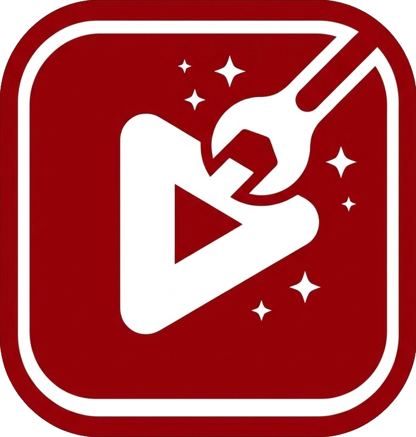

<h1 align="center">YouMod</h1>

<a href="https://github.com/Tonwalter888/YouMod/releases/latest"></img></a>
 

A YouTube tweak that tries to recreate features from mods such as YTLite and Morphe as much as possible. Contributions are welcome! ^^

Thanks for over 790 stars and 2.1k forks! This might be the best project I've done.

If you want to contribute this project, scroll down to `How to contribute this project?` part.

## Why did I create this project?
The reason is because of YTLite no longer being free. So I'll try my best to recreate all the features as much as I can, plus features from other tweaks.

## Features
This tweak adds a lot of QoL features, such as:
- Downloading (Video, audio, subtitles, thumbnail, video details, etc.)
- Appearance (OLED theme and keyboard)
- Navigation bar (Hiding buttons)
- Player (Hiding elements, buttons, and add custom actions, etc.)
- Shorts (Hiding elements and adding custom actions)
- Tab bar (Reorder tabs, hiding things, etc.)
- Built-in SponsorBlock
- Hiding unwanted elements
- And much more!

## Supported YouTube version
Up to the latest, this is the goal of this tweak. Any versions starting from 20.x - latest and running at least iOS 15.

## How to build an IPA with YouMod?
1. Click on **Sync fork**, and if your branch is out-of-date, click on **Update branch**.
2. Navigate to **Actions** in your forked repository and select **Build IPA with tweaks**.
3. Click the **Run workflow** button located on the right side.
4. Get a decrypted .ipa file (I cannot provide this due to legal reasons)
5. Upload the decrypted .ipa file to a file sharing site (e.g., https://filebin.net, https://filemail.com, https://catbox.moe, Mega, or Dropbox is recommended).
6. Paste the URL of the decrypted IPA file in the provided field.
    - You can also change the BundleID and Display Name if desired.

**NOTE:** Make sure to provide a direct download link to the file or a link on Mega, not a link to a webpage. Otherwise, the process will fail.

7. Make sure all inputs are correct, then click **Run workflow** to start the process.
8. Wait for the build to finish. You can download the YouMod IPA from the releases section of your forked repo.
    - If you can't find the releases section, go to your forked repo and add `/releases` to the end of your repository's URL. (i.e., `github.com/yourusername/YouMod/releases`)

## How to contribute to this project?
1. Find or create an issue with the bug you're facing or a feature missing. (Workflows and localizations do count)
2. Clone the repository.
3. Create a new branch for your changes.
4. Implement your changes and ensure that they are well-tested, commit your changes and push to your branch.
5. On your fork repository, click **Contribute** button to create a new pull request (PR) from your branch.
    - In the PR description, reference the issue you're addressing (e.g., `"Closes #123"`, `I found this issue from ...`, `Update this workflow to ...`, `Update this language localizations`) and send screenshots or videos proving your codes work without any issues (Only send this if you are not modifying the localizations).
    - Once your PR is submitted, one of the maintainers or collaborators may review it and ask for changes or feedback. Make any necessary adjustments, and respond to comments as needed.

## License
This project uses GPLv3 license. See [LICENSE](https://github.com/Tonwalter888/YouMod/blob/main/LICENSE) for more details.

## Team
YouMod is being worked on by a team of three
* [Tonwalter888](https://github.com/Tonwalter888) - Founder
* [G Rohit](https://github.com/grohit1810) - Collaborator
* [Zomka](https://github.com/ZomkaDEV) - Collaborator

## Credits
- [YTLite](https://github.com/dayanch96/YTLite) - dayanch96
- [YTMusicUltimate](https://github.com/dayanch96/YTMusicUltimate) - dayanch96
- [OLEDKeyboard](https://github.com/dayanch96/OLEDKeyboard) - dayanch96
- [YTLitePlus](https://github.com/YTLitePlus/YTLitePlus)
- [uYouEnhanced](https://github.com/arichornlover/uYouEnhanced) - arichornlover
- [YTweaks](https://github.com/fosterbarnes/YTweaks) - fosterbarnes
- [jefemagril](https://github.com/jefemagril) - Implemented rewind/fast forward buttons to system Control Center
- [AppropriateNet2928](https://github.com/AppropriateNet2928) - Experimental playback fix
- [SponsorBlock](https://sponsor.ajay.app) - SponsorBlock segments API
- [Google Fonts](https://fonts.google.com/icons) - Icons for custom tabs
- And [PoomSmart](https://github.com/PoomSmart)'s tweaks

Also thanks to the others who contributed in the past!
